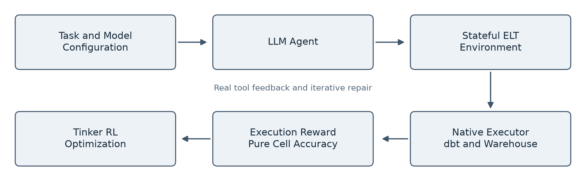

# ELT Bench RLVR

Version **0.6.1**. An execution-verified reinforcement learning framework for end-to-end ELT tasks, adapted to run under an ordinary Linux account.

Read the [Implementation Design](docs/Implementation_Design.docx) for the four-page system design and the two recorded experiments.

## Project overview

An LLM agent inspects a task, writes extraction/loading configuration and dbt models, executes the pipeline, repairs errors from real feedback, and submits its current project. A trusted evaluator queries the resulting warehouse. Tinker performs model sampling and optimization; the server orchestrates native services and warehouse work.

## Key features

- Stateful, isolated rollouts with structured tools and actual execution feedback.
- Native PostgreSQL, HTTP/HTTPS and S3 sources; no Docker, sudo or local GPU.
- Configurable task, model, source, warehouse, reward and evaluator interfaces.
- Pure cell accuracy and the existing Tinker Cookbook group-relative training recipe.
- Independent evaluation, resumable checkpoints and protection against duplicate optimizer updates.

## System architecture



Each rollout owns its workspace, source services, warehouse namespace and execution state. Native declarative loading replaces the original Airbyte Platform/Terraform interface. Original task data, target definitions and the pinned official evaluator are preserved. This is a **Docker-free adaptation**, with different loading tools and feedback from the original benchmark environment.

## Installation

Use Python 3.12, Git and an ordinary Linux account. Official execution additionally needs user-executable PostgreSQL binaries and authorized Snowflake access. The credential-free example uses HTTP, DuckDB and dbt.

```sh
python3.12 -m venv .venv
.venv/bin/pip install torch==2.15.0 --index-url https://download.pytorch.org/whl/cpu
.venv/bin/pip install -e '.[native,dev]' -c tools/native-linux-control.lock
python3.12 -m venv .venv-dbt
.venv-dbt/bin/pip install -r tools/python-tools.lock
export ELT_DBT_EXECUTABLE="$PWD/.venv-dbt/bin/dbt"
```

The Cookbook dependency is pinned to commit `8bf7dd6192a3f1fa64640a04ec54a7f6866bbd83`. A host with failing GitHub Git transport can use the verified same-commit wheel procedure in [deployment](docs/DEPLOYMENT.md). Final clean-environment validation records that installation route explicitly.

## Credential-free local integration test

```sh
.venv/bin/elt-rl demo --output runs/local-integration.json
```

This executes actual HTTP extraction, native loading, DuckDB and dbt. It uses a small engineering fixture, not an official benchmark task. See [the recorded integration result](evidence/native-integration.json) and [validation](docs/VALIDATION.md).

## Official ELT-Bench rollout

Copy `examples/runtime.example.json` to `private/runtime.json`, set authorized service identities and private key paths, and select the fixed dbt executable. Keep this file and credentials outside model workspaces and release packages.

```sh
git clone https://github.com/uiuc-kang-lab/ELT-Bench vendor/ELT-Bench
git -C vendor/ELT-Bench checkout e2e377766604f61930165f20d4fcab8400a3e997
.venv/bin/elt-rl fetch-assets --repo vendor/ELT-Bench --name cars --output data/original/cars
.venv/bin/elt-rl prepare-task --repo vendor/ELT-Bench --name cars \
  --assets data/original/cars --runtime-config private/runtime.json --output data/tasks/cars-native
.venv/bin/elt-rl run-project --task examples/tasks/cars.yaml \
  --project evidence/representative-rollout/submission/pipeline.json \
  --output runs/official-replay.json --allow-remote
```

The supplied pipeline is an authentic **imperfect model submission**, with 12/21 correct cells. Its [loading declaration](evidence/representative-rollout/submission/elt/loading.json), [dbt SQL](evidence/representative-rollout/submission/dbt/models/countries.sql), [actual prediction](evidence/representative-rollout/predictions/countries.csv) and [execution result](evidence/representative-rollout/rollout.json) are included. `run-project` returns exit code 1 when full task success is false, even if execution and a partial reward were recorded. Release preparation did not replay this credentialed pipeline.

## Tinker RL training

```sh
.venv/bin/elt-rl inspect-experiment --config examples/cars.yaml
.venv/bin/elt-rl configure-tinker
.venv/bin/elt-rl train --config examples/cars.yaml --allow-remote
```

Each batch samples eight independent rollouts from one checkpoint. Cookbook computes `A_i = R_i - mean(R_group)` and assembles masked training data. One importance-sampling forward/backward and Adam step updates the model. Learning rate is 1e-5, LoRA rank 16 and temperature 0.8 in the supplied examples. Equal-reward groups complete without an ineffective update. Every effective update saves training-state and sampler checkpoints.

`examples/human_resources.yaml` selects Qwen/Qwen3.6-35B-A3B and one eight-rollout batch, with evaluation disabled. Prepare its assets using the same commands with task `human_resources` and output `data/tasks/human-resources-native`. A supported fresh model needs no historical checkpoint. These commands initiate new work only when the operator runs them; no new paid experiment was started for this release.

## Evaluation and reward

The default training reward is **correct required cells / all official target cells**. Keys align rows; missing cells earn zero while remaining in the denominator. Every cell has equal weight. Multiple targets use a micro average, and numerical tolerance yields binary credit without proximity rewards.

Official metrics remain separate: **SRDEL** counts successful loading pipelines; **SRDT** counts correct target data models divided by all target models; **end-to-end success** requires successful loading and every target model correct. For two target tables with one correct, SRDT is 0.5 and whole-pipeline success is false. See the [official definitions](https://arxiv.org/html/2504.04808v1#S3.SS1) and [metric correction](docs/EVALUATION_PROTOCOL.md).

Process and final evaluation never enter gradients. Evaluation reports mean, population standard deviation, minimum, maximum and per-cell correctness. The full cars schedule uses 50 process and 40 independent final rollouts. Final selection uses the last effective checkpoint, with matching tasks, prompts, tools, temperature, seed plan and limits for the initial and final policies.

## Adding new tasks

Provide verified assets, target types, reliable row alignment and an evaluator through `TaskSpec`. Reuse compatible source/warehouse adapters or add a trusted adapter for an unsupported capability. See [task onboarding](docs/ADDING_TASKS.md) and [interface contracts](docs/INTERFACES.md).

## Adding new models

Declare the model in `src/elt_rl/model_catalog.json`, selecting its Cookbook tokenizer, renderer, tool codec and verified limits/capabilities. Implement a trusted adapter only if the native tool format requires it. Sampling logprobs, tool calling and LoRA training must be supported. The Qwen XML adapter preserves string arguments such as JSON file content. Unknown models fail explicitly; a model name alone is not an adapter.

## Experimental results

| Recorded experiment | Model | Training rollouts | Effective updates | Independent final evaluation |
|---|---|---:|---:|---|
| Cars training | Inkling-2-Mini | 128 in 16 batches | 15 | Initial 55.71%, final 57.38%; 20 each |
| Human Resources verification | Qwen3.6-35B-A3B | 8 in one batch | 1 | Not run |

Cars final SRDEL was 100% and SRDT/whole-pipeline success 0% for both policies. The observed +1.67 percentage points is **not evidence of a statistically significant improvement**. Human Resources verifies cross-model/task execution and optimization, not performance improvement. Its corrected training-cohort SRDT is 12.5% (2/16 target models), with whole-pipeline success 0%. See [actual configurations and receipts](evidence/experiment-index.json), [results](docs/RESULTS.md) and [acceptance evidence](docs/ACCEPTANCE.md).

## Known limitations

Only the two task/model combinations above have the reported real validation. Other compatible tasks/models require individual qualification; all benchmark tasks and Tinker models have not been validated. Equal rewards may legitimately prevent an update. Native loading changes the available tools relative to the original environment. SDK seeds do not guarantee deterministic service behavior, and its public optimizer response does not expose a request ID.

Token limits bound execution; **no dollar-budget enforcement or storage-quota preflight is implemented**. Actual costs were not measured for these runs. Learned weight objects remain in the authorized Tinker account; published checkpoint metadata is not a local binary export. Source licensing is not selected, and benchmark assets are fetched separately. See [third-party notices](THIRD_PARTY_NOTICES.md).

## Reproduction instructions

After preparing the pinned task, recompute the included prediction's reward without inference or warehouse calls:

```sh
.venv/bin/python tools/verify_saved_rewards.py \
  --input evidence/representative-rollout/reward-context.json \
  --reference-task-spec examples/tasks/cars.yaml --output runs/recomputed-reward.json
.venv/bin/ruff check src tests tools
.venv/bin/ruff format --check src tests tools
.venv/bin/pytest -q
```

Public evidence contains the representative actual prediction, selected metrics, curves, optimizer receipts and checkpoint lineage. Complete original trajectories and historical versions are archived privately. Historical resume requires each run's original source and frozen inputs; do not substitute a new release fingerprint. See [deployment](docs/DEPLOYMENT.md), [validation](docs/VALIDATION.md) and [publication/conversion steps](docs/PUBLICATION.md). This reviewed 0.6.1 release is published from a clean source export. No collaborators have been invited; private document sharing remains controlled by the owner.
